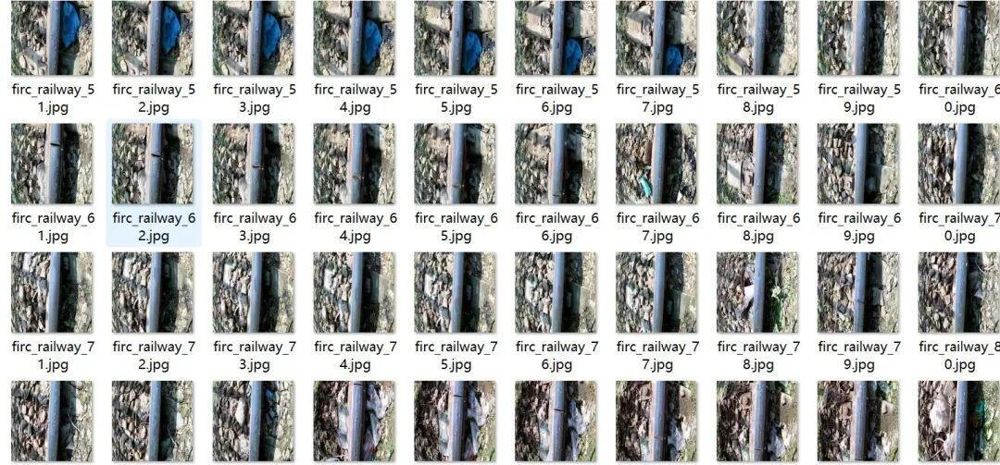
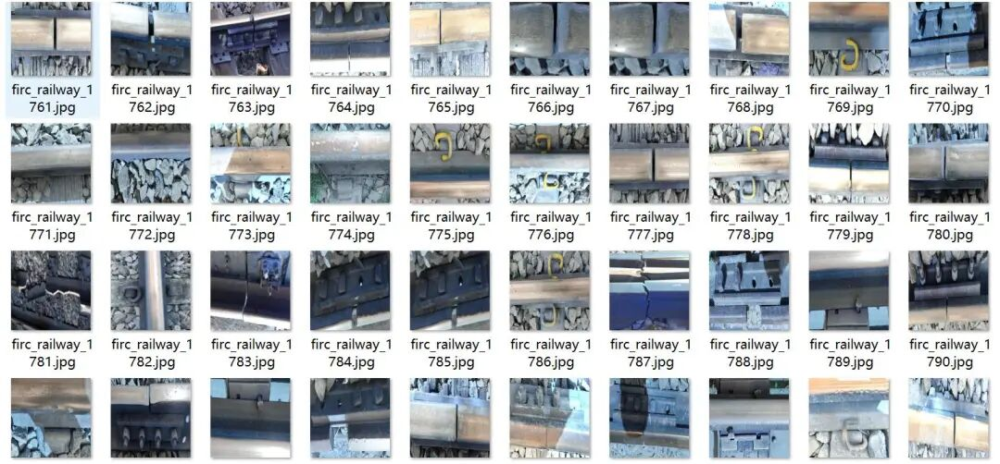
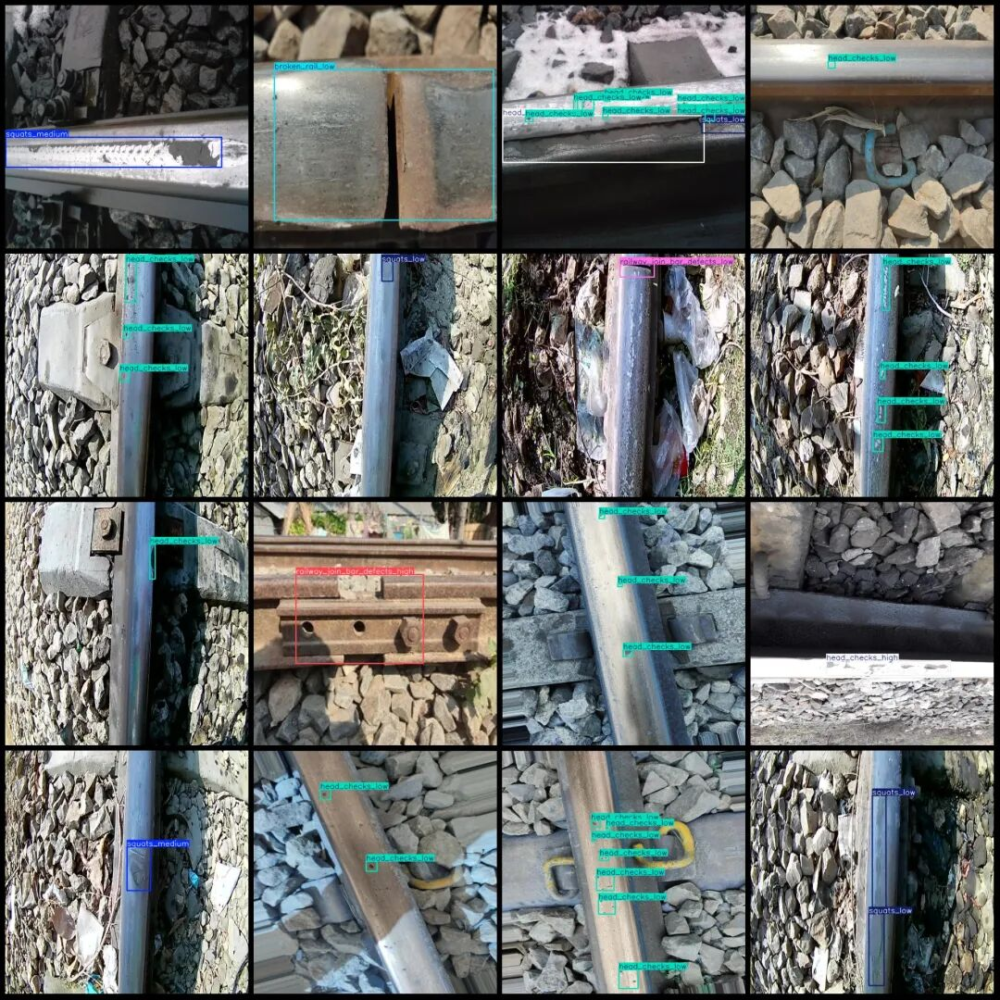
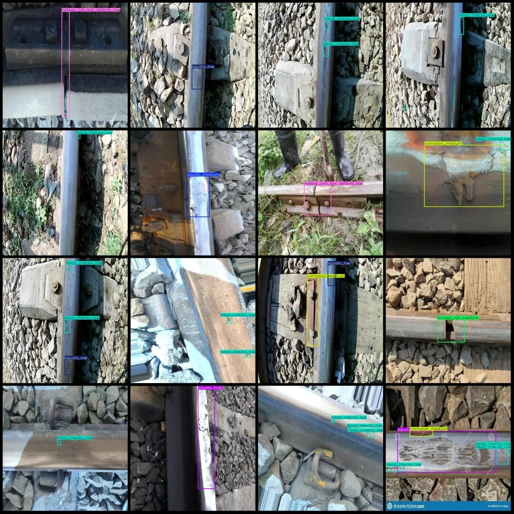

# Intelligent Transportation and Railway Inspection Data Set: 15 Categories, VOC+YOLO Format, 2324 Images

Dataset format: Pascal VOC format + YOLO format (txt file without split path, only containing jpg images and corresponding VOC format xml files and yolo format txt files)

Number of images (number of jpg files): 2324

Number of annotations (number of xml files): 2324

Number of annotations (number of txt files): 2324

Label category count: 15

Label names: ["broken_rail_high", "broken_rail_low", "broken_rail_medium", "corrosion_high", "corrosion_low", "corrosion_medium", "head_checks_high", "head_checks_low", "head_checks_medium", "railway_join_bar_defects_high", "railway_join_bar_defects_low", "railway_join_bar_defects_medium", "squats_high", "squats_low", "squats_medium"]

Number of boxes labeled in each category:

Broken_rail_high (Railway rail fracture - Severe) Frames = 135

Broken_rail_low (Rail Breaking - Mild) frame count = 84

Broken_rail_medium (Railway Rail Break - Moderate) Frames = 48

corrosion_high (corrosion - severe) frame count = 25

corrosion_low (corrosion - mild) frame count = 15

corrosion_medium (corrosion medium) frame count = 18

head_checks_high (rail head crack - severe) frame count = 180

head_checks_low (rail head crack - light) frame count = 3724

head_checks_medium (rail head crack - moderate) frame count = 222

Railway Join Bar Defects High (Fishtail Plier Defects - Severe) Frame Count = 67

Railway Join Bar Defects - Low (171)

Railway Join Bar Defects Medium (Fishtail Pliers Defects - Moderate) Frame Count = 59

squats_high (rail indentation - heavy) frame count = 67

squats_low (rail indentation - mild) frame count = 565

squats_medium (rail indentation - medium) frame count = 112

Total frame count: 5492

Image resolution: 640x640

Application Fields: These are common categories for railway track defect detection, and they are further divided into minor, moderate, and severe based on the severity level.

Using labelImg:

Annotation rules: Draw a rectangle around the category.

Important Notice: No

Special : This dataset does not guarantee the accuracy of the trained models or weight files.

Image Preview:

Annotation example:

## Payment

Here is a pay link on Stripe ( https://buy.stripe.com/3cs8yP7sY87d0vu9AB ). Please contact me lonlonago@foxmail.com after funding $89, and I will send you a complete data files , thank you!

